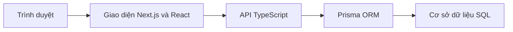

# EcoEcho

EcoEcho là website truyền thông về lối sống xanh. Dự án giúp mình thực hành phát triển một ứng dụng web từ giao diện đến API và cơ sở dữ liệu.

## Phần mình phụ trách

- Thiết kế và phát triển giao diện bằng Next.js, React và Tailwind CSS.
- Xây dựng API và xử lý dữ liệu bằng TypeScript.
- Làm việc với cơ sở dữ liệu SQL qua Prisma ORM.
- Triển khai và vận hành website trên máy chủ.

## Kiến trúc

Sơ đồ mô tả luồng xử lý ở mức tổng quan. Xem thêm [CV của Nguyễn Tâm](https://github.com/Tamz32/baitap).
